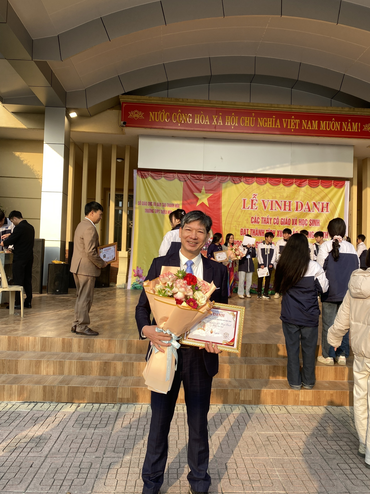

🌻 Lời Ngỏ Tháng Mười Một — "Người Gieo Hạt Nắng""Có một nghề bụi phấn bám đầy tayNgười ta bảo đó là nghề trong sạch nhấtCó một nghề không trồng cây vào đấtMà mang lại cho đời đầy trái ngọt hoa tươi..."Người Gieo Hạt Nắng là ấn phẩm tập san điện tử kỷ niệm Ngày Nhà giáo Việt Nam 20/11 của tập thể Chi đoàn 12C4 (Niên khóa 2024 – 2027) — Trường THPT Thiệu Hóa, Tỉnh Thanh Hóa.Cuốn tập san là món quà tinh thần gói trọn tấm lòng tri ân sâu sắc của đại gia đình 12C4 gửi tới Thầy chủ nhiệm cùng quý Thầy Cô giáo — những người lái đò thầm lặng đã tận tụy truyền lửa tri thức, chắp cánh ước mơ và đồng hành cùng chúng em qua những năm tháng thanh xuân tươi đẹp nhất dưới mái trường THPT Thiệu Hóa.

📸 Dấu Ấn Thanh Xuân Chi Đoàn 12C4

<table>
<tr>
<td align="center" width="50%">

    <b>🌸 Tập Thể 12C4 Bên Thầy Cô Kính Yêu</b>
  </td>
  <td align="center" width="50%">
    
     

    <b>👨‍🏫 Thầy Chủ Nhiệm & Kỷ Niệm Lớp 12C4</b>
  </td>
</tr>
</table>

👑 Ban Biên Tập Tập San 12C4

<h3>Thanh Long ❤️‍🩹</h3>

<b>Trưởng Nhóm • Thiết Kế & Phụ Trách Dự Án Tập San Điện Tử 12C4</b>

Thành viênVai trò phụ tráchĐơn vịThanh Long ❤️‍🩹Trưởng nhóm • Thiết kế & Phụ trách chungChi đoàn 12C4 — THPT Thiệu HóaMai TrangBiên tậpChi đoàn 12C4 — THPT Thiệu HóaHuyền TrangNội dungChi đoàn 12C4 — THPT Thiệu HóaÁnh TuyếtHình ảnhChi đoàn 12C4 — THPT Thiệu Hóa

🌐 Thông Tin Liên HệĐơn vị: Chi đoàn 12C4 (Khóa 2024 – 2027) — Đoàn Trường THPT Thiệu Hóa, Tỉnh Thanh HóaTrưởng nhóm thực hiện: Thanh Long ❤️‍🩹Facebook: facebook.com/htl165TikTok: tiktok.com/@tlongmmoThước phim kỷ niệm 12C4: youtu.be/7IcD-3GG7Ts

