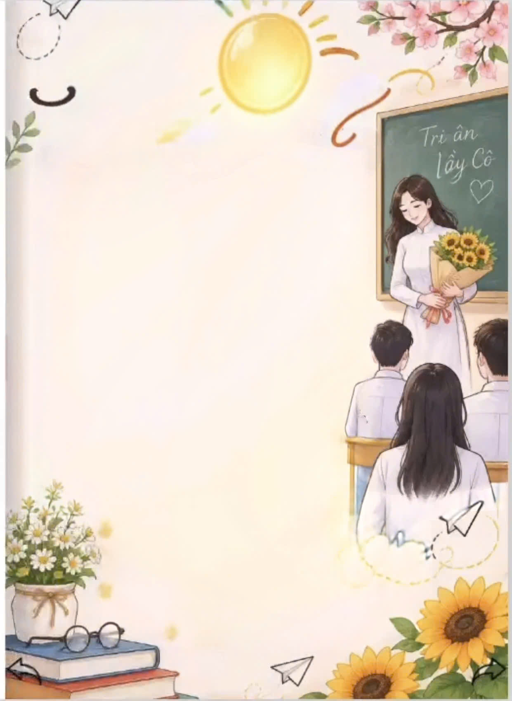
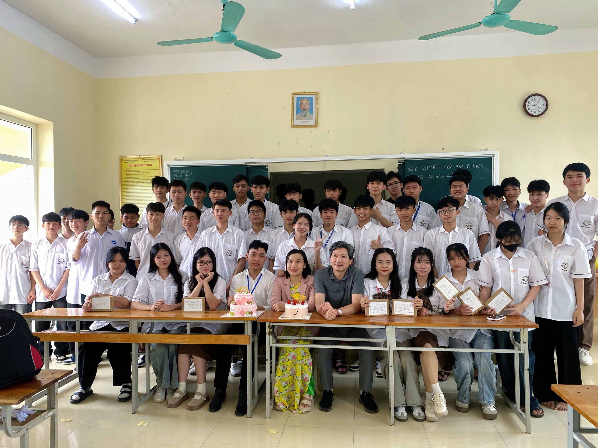

<!-- HIỆU ỨNG SÓNG CHUYỂN ĐỘNG ĐẦU TRANG (ANIMATED WAVE HEADER) -->
<!-- HIỆU ỨNG CHỮ CHẠY TỰ ĐỘNG (TYPING SVG ANIMATION) -->
<!-- BỘ HUY HIỆU NỔI BẬT (GLOWING BADGES) -->

&nbsp;

&nbsp;

🌸 Thông Điệp Tri Ân — "Người Gieo Hạt Nắng""Có một nghề bụi phấn bám đầy tayNgười ta bảo đó là nghề trong sạch nhấtCó một nghề không trồng cây vào đấtMà mang lại cho đời đầy trái ngọt hoa tươi..."Người Gieo Hạt Nắng là ấn phẩm tập san điện tử đặc biệt chào mừng Ngày Nhà giáo Việt Nam 20/11 của tập thể Chi đoàn 12C4 (Niên khóa 2024 – 2027) — Trường THPT Thiệu Hóa. Cuốn sổ tay là nơi hội tụ những vần thơ trong trẻo, những dòng tản văn xúc động, giai điệu Bụi Phấn thân thương và những bức hình lưu giữ trọn vẹn thanh xuân rực rỡ của đại gia đình 12C4 bên Thầy chủ nhiệm cùng quý Thầy Cô giáo.

🖼️ Không Gian Nghệ Thuật & Kỷ Niệm 12C4

<table>
<tr>
<td align="center" width="50%">

    <b>📖 Trang Mục Lục Nghệ Thuật</b>
  </td>
  <td align="center" width="50%">
    
     

    <b>🌻 Lời Ngỏ: Thắp Sáng Ước Mơ</b>
  </td>
</tr>
<tr>
  <td align="center" width="50%">
    
     

    <b>📸 Tập Thể 12C4 Bên Thầy Cô Kính Yêu</b>
  </td>
  <td align="center" width="50%">
    
     

    <b>👨‍🏫 Thầy Chủ Nhiệm & Kỷ Niệm Lớp 12C4</b>
  </td>
</tr>
</table>

📑 Hành Trình Khám Phá 15 Trang Tập San

<b>✨ Nhấn để xem chi tiết từng trang trong cuốn Tập San 12C4</b>

TrangChuyên mụcĐiểm nhấn nội dung🌟 01Bìa ChínhNgười Gieo Hạt Nắng — Ấn phẩm Tri Ân 20/11 của Chi đoàn 12C4🧭 02Mục LụcSơ đồ 14 chuyên mục tương tác — chạm trực tiếp để mở nhanh tới từng trang💌 03Lời NgỏThắp Sáng Ước Mơ — Lời tri ân gửi tới những người lái đò thầm lặng🏛️ 04 – 05Tự Hào Trường EmChặng đường lịch sử vẻ vang Trường THPT Thiệu Hóa (từ 1972) & Phiến Đá Khát Vọng✒️ 06 – 07Thơ & Văn XuôiThơ Ngày Nhà Giáo (Trần Thị Quỳnh) & tản văn Chuyến Đò Tri Ân🎶 08 – 09Ca Dao & Giai ĐiệuCa dao tôn sư trọng đạo & bản nhạc Bụi Phấn tự động ngân vang khi mở trang🌼 10 – 11Thơ Kỷ Niệm LớpMùi Hoa Sữa (Trịnh Minh Hòa) & Lời Hẹn Ngày Gặp Lại (Trần Lương Tuấn Hưng)📌 12 – 13Bảng Ghim Kỷ NiệmKhông gian ảnh Polaroid & giấy nhớ lưu giữ khoảnh khắc Đại gia đình 12C4✍️ 14Sổ Vàng Lưu BútBảng ghim lời chúc 20/11 và tâm tình tuổi học trò của tập thể 12C4🎬 15Lời Kết & Thước PhimLời chào thanh xuân & Video kỷ niệm 12C4

🪄 Trải Nghiệm Tương Tác Sống Động📖 Hiệu ứng lật sách 3D chân thực: Chạm, vuốt nhẹ qua trái/phải hoặc dùng phím mũi tên ← / → để lật từng trang giấy kèm âm thanh sột soạt tự nhiên.🎵 Hòa âm cảm xúc tự động: Giai điệu nhạc nền êm dịu xuyên suốt cuốn tập san và tự động chuyển sang khúc ca Bụi Phấn khi bạn dừng chân tại Trang 08 – 09.🔍 Phóng to từng khoảnh khắc: Chạm vào bất kỳ bức ảnh kỷ niệm nào trên các trang sách để ngắm nhìn rõ nét từng nụ cười của thầy trò 12C4.📌 Ghim Lưu Bút Tri Ân (Trang 14): Tự tay chọn màu giấy nhớ, viết lời chúc gửi tới thầy cô, bạn bè và ghim trực tiếp lên Sổ Vàng Lưu Bút 12C4.

👑 Đội Ngũ Thực Hiện Ấn Phẩm

<h3>🌟 Thanh Long ❤️‍🩹</h3>

<b>Trưởng Nhóm • Thiết Kế & Phụ Trách Dự Án Tập San Điện Tử 12C4</b>
<table>
<tr>
<td align="center"><b>👑 Trưởng nhóm</b> Thanh Long ❤️‍🩹</td>
<td align="center"><b>📝 Biên tập</b> Mai Trang</td>
<td align="center"><b>✒️ Nội dung</b> Huyền Trang</td>
<td align="center"><b>📸 Hình ảnh</b> Ánh Tuyết</td>
</tr>
</table>

<b>Đơn vị:</b> Chi đoàn 12C4 — Đoàn Trường THPT Thiệu Hóa 
📘 <b>fb:</b> <a href="https://facebook.com/htl165">facebook.com/htl165</a> &nbsp;|&nbsp; 🎵 <b>tt:</b> <a href="https://tiktok.com/@tlongmmo">tiktok.com/@tlongmmo</a>

<!-- HIỆU ỨNG SÓNG CHUYỂN ĐỘNG CUỐI TRANG (ANIMATED WAVE FOOTER) -->

